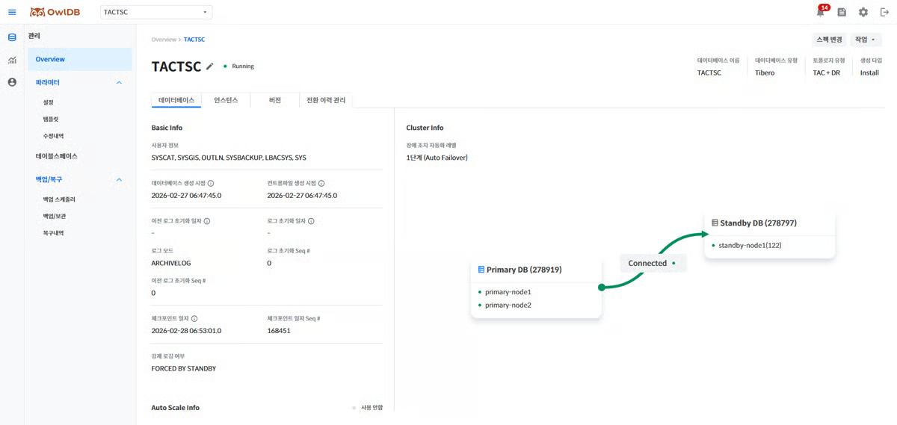
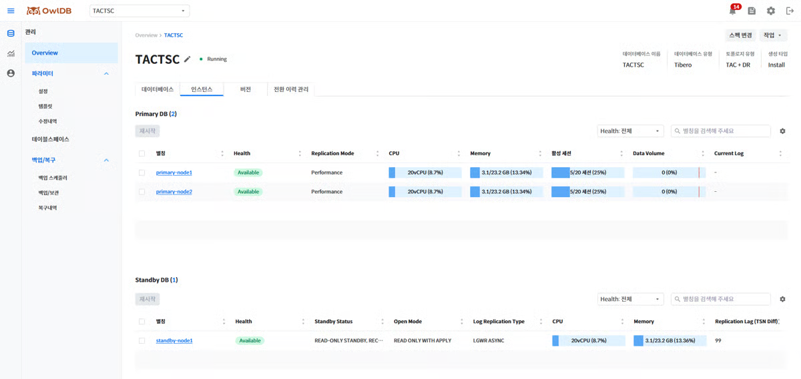

# DB Service

Query the status of databases running in OwlDB and perform operations such as modify, stop, start, delete, role switch, license renewal, and spec change.


**Note**

* If the instance status is not `Running`, some information may be missing.
* Because the database management page displays times based on the database timezone, there may be a difference from the local system time (browser time).


***

### View Database Information 

1. Click the **Management > Overview** menu.
2. Click the **DB Service Name** dropdown button and select the database whose information you want to view.
3. Check the detailed information in the Operational Information, Instance, Version, and (DR/HA) Switch History Management tabs.


**Note**

For the database operational status, please refer to the **Overall Status Summary Information** page.




<figure><figcaption>
Figure 1. Operational Information
</figcaption></figure>

You can check detailed database information such as the account information that can access the database, control files, logs, and checkpoints, and you can visually check the database configuration as a diagram.


**Note**

All items that display a date and time are shown based on the database timezone.




<figure><figcaption>
Figure 2. Instance
</figcaption></figure>

Check the list and information of the configured instances.

* Clicking an **instance alias** moves you to the "[Instance Management](db-service.md#dF57s45IXBUgU7RX1UvL)" page.
* You can first select one or more instances with the ☑️ icon and then click the **Restart** button, or click the **Restart** button directly without a selection to open a modal where you can select the instances to restart and the restart options. For details, please refer to "[Restart Instance](db-service.md#undefined-2)".


**Note**

When using a DR configuration, the query distinguishes between the Primary (Leader) DB and the Standby (Replica) DB.




Check the database version information, system and compile information, and patch (or Extension) information.

The system and compile information displays binary OS information and so on as a list, regardless of the engine. The Basic Info and patch information vary by engine as follows.

| Item                           | Tibero                                                                                                                                           | OpenSQL                                                                                                                                                                  |
| ------------------------------ | ------------------------------------------------------------------------------------------------------------------------------------------------ | ------------------------------------------------------------------------------------------------------------------------------------------------------------------------ |
| Basic Info                     | <ul><li>Major version</li><li>Minor version</li><li>Patchset version</li></ul>                                                                   | <ul><li>OpenSQL version (e.g., 3.0)</li><li>PostgreSQL version (e.g., 17.5)</li></ul>                                                                                    |
| System and Compile Information | Displays a list of binary OS information and so on                                                                                               | Displays a list of binary OS information and so on                                                                                                                       |
| Patch Information / Extensions | <ul><li>Displays a list of the applied patch status</li><li>If there are none, the message "No patches have been applied" is displayed</li></ul> | <ul><li>Displays a list of the currently installed Extensions</li><li>Extensions added via DDL during operation are also reflected as of the time of the query</li></ul> |


**Note**

Items whose value cannot be retrieved are displayed as `-`.




This tab is provided for a Tibero DR configuration or an OpenSQL HA configuration.

Check the history of database role switch events that have occurred.


**Note**

For OpenSQL, the role switch is performed by Patroni, and OwlDB checks that the node role has changed and reflects it in the history. At this time, since it does not distinguish whether the switch is a Switchover performed by the user or a Failover performed by Patroni, the type is all recorded as `Failover`.


| Column name      | Description                                                                                                                                               | Data type                                                                                                                                                                                                                                                                                                                                                                                                                                                                                                                                     | Default value | Required value |
| ---------------- | --------------------------------------------------------------------------------------------------------------------------------------------------------- | --------------------------------------------------------------------------------------------------------------------------------------------------------------------------------------------------------------------------------------------------------------------------------------------------------------------------------------------------------------------------------------------------------------------------------------------------------------------------------------------------------------------------------------------- | ------------- | -------------- |
| ID               | <ul><li>A number that uniquely identifies the switch event</li><li>Format: {event type-random string 16 bytes}</li><li>Event type: FO / SO / FB</li></ul> | <ul><li>FO-3f9a7c1e2d8b45f0</li><li>SO-b17e4a93d2c68f5e</li><li>FB-7a2d9e14c6b83f05</li></ul>                                                                                                                                                                                                                                                                                                                                                                                                                                                 | O             | X              |
| Start Time       | The time at which the switch event occurred                                                                                                               | yyyy.mm.dd HH\\:mm:ss                                                                                                                                                                                                                                                                                                                                                                                                                                                                                                                         | O             | O              |
| Completion Time  | The time at which the switch event was completed                                                                                                          | yyyy.mm.dd HH\\:mm:ss                                                                                                                                                                                                                                                                                                                                                                                                                                                                                                                         | X             | X              |
| Type             | Switch Event Type                                                                                                                                         | <ul><li>Failover</li><li>Switchover</li><li>Failback</li></ul>                                                                                                                                                                                                                                                                                                                                                                                                                                                                                | O             | O              |
| Execution Target | The target that performed the event                                                                                                                       | <ul><li>Switchover: {user ID}</li><li>Failover: {user ID} / system (Auto Failover)</li><li>Failback: {user ID}</li></ul>                                                                                                                                                                                                                                                                                                                                                                                                                      | O             | X              |
| Result           | Displays the status of the event                                                                                                                          | <ul><li>Success</li><li>Failure</li></ul>                                                                                                                                                                                                                                                                                                                                                                                                                                                                                                     | O             | X              |
| Cause/Remarks    | Displays the cause of the event, the value entered by the user, or the failure reason                                                                     | <ul><li>A value optionally entered by the user during the role switch (up to 200 characters, blank if not entered)</li><li>The trigger condition for Auto Failover</li><li>On Failback failure: Standby/Replica Reboot Failed or Switchover Failed</li><li>On Failover failure: Standby/Replica Promotion Failed</li><li>On post-processing failure after a successful Failover: Cluster Normalization Failed (Primary scale out failed / New Standby/Replica creation failed; if multiple failures, displayed separated by commas)</li></ul> | O             | X              |



***

### Edit DB Service information 

1. Click the **pencil icon** next to the DB Service alias.
2. Edit the DB Service alias and description.
3. Click the **Save** button.
